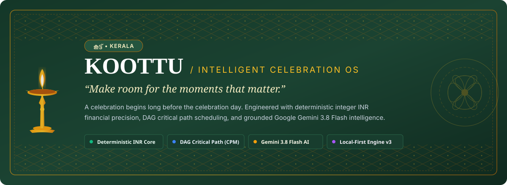
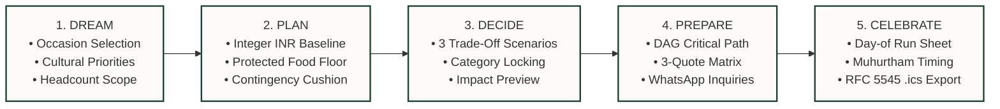
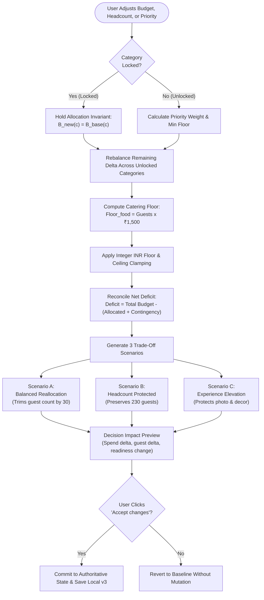
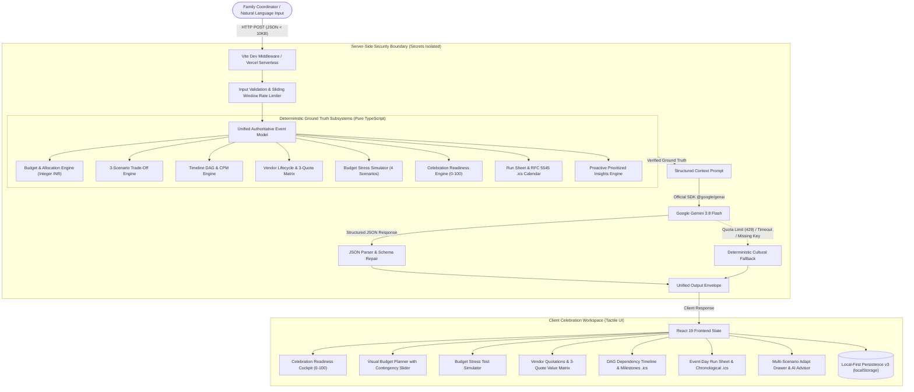
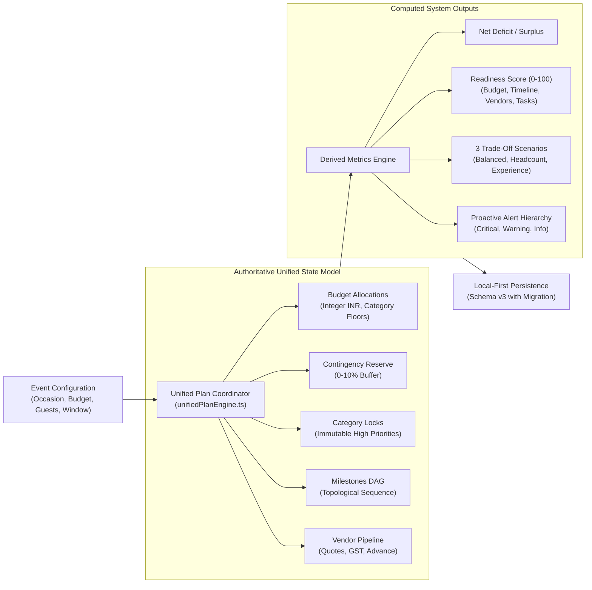
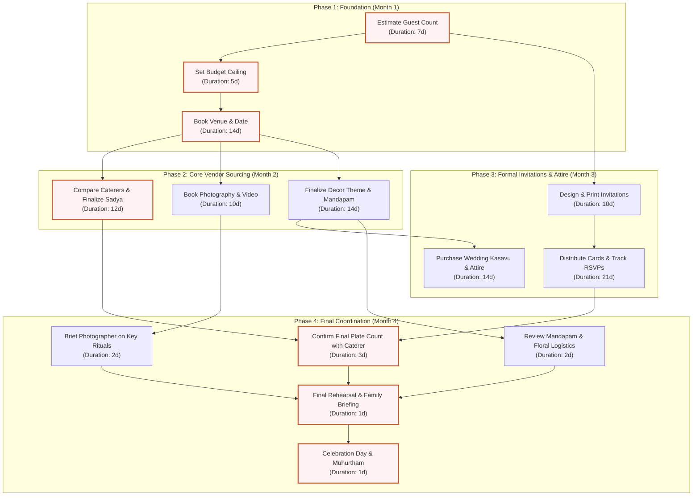
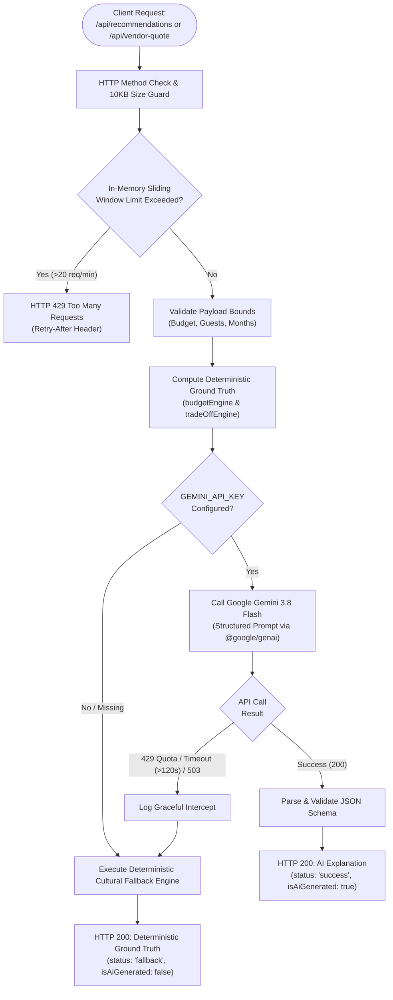

<div align="center">



# KOOTTU • കൂട്ട്
### *An Intelligent Celebration Operating System*

**"Make room for the moments that matter."**

[](README.md)
[](README.md)
[](README.md)
[](README.md)
[](README.md)
[](README.md)
[](README.md)
[](README.md)

<p align="center">
  <a href="#1-the-koottu-philosophy"><strong>Philosophy</strong></a> •
  <a href="#2-the-celebration-journey"><strong>Journey</strong></a> •
  <a href="#3-the-numbers-behind-a-celebration"><strong>Financial Reality</strong></a> •
  <a href="#4-anatomy-of-a-decision"><strong>Decision Flow</strong></a> •
  <a href="#5-product-gallery"><strong>Product Gallery</strong></a> •
  <a href="#6-kerala-cultural-roots"><strong>Cultural Roots</strong></a> •
  <a href="#7-engineering-made-visible"><strong>Engineering Core</strong></a> •
  <a href="#8-getting-started--verification"><strong>Quickstart</strong></a>
</p>

</div>

<p align="center">
  
</p>

---

## 1. The KOOTTU Philosophy

> *“A celebration begins long before the celebration day.”*

In Indian cultural traditions—and especially across Kerala—a celebration is not an individual project. It is a shared community alliance: families gathering across generations, sacred timing (*Muhurtham*), feast logistics (*Sadya*), and artisanal commitments.

Yet modern event coordination often collapses into chaotic WhatsApp groups, fractured spreadsheets, and painful budget surprises. When families turn to generic AI chatbots, they encounter a dangerous flaw: **LLMs hallucinate arithmetic, invent uncommitted funds, and ignore unforgiving timeline dependencies.**

KOOTTU was engineered around an uncompromising architectural principle:

<div align="center">

```
┌────────────────────────────────────────────────────────────────────────┐
│  "AI can help imagine the possibilities.                              │
│   The planning engine must account for the consequences."              │
└────────────────────────────────────────────────────────────────────────┘
```

</div>

### The Five Core Tenets

| Principle | Engineering Manifestation |
| :--- | :--- |
| **1. Every rupee should have a reason.** | All financial computations use pure **integer INR arithmetic** in TypeScript. No floating-point penny drift. |
| **2. Every important task should have an owner.** | Structured **DAG scheduling** with early-start, early-finish, and critical path propagation. |
| **3. Every trade-off should be visible.** | When you reduce headcount, savings are computed exactly; unresolved deficits remain honest and transparent. |
| **4. Every family decision deserves clarity.** | High-priority allocations can be **locked** so rebalancing algorithms never touch them. |
| **5. AI should assist, not invent certainty.** | Google Gemini 3.8 Flash interprets nuance and crafts advice; deterministic engines enforce ground truth. |

<p align="center">
  
</p>

---

## 2. The Celebration Journey

From initial cultural vision to the auspicious moment of the ceremony, KOOTTU accompanies the family through five interconnected phases:



### The Five Stages in Practice

1. **DREAM — Cultural Calibration**: Select the celebration archetype (*Wedding / Kalyanam*, *Engagement / Nischayam*, or *Housewarming / Grihapravesham*), define total budget, guest count, and planning horizon.
2. **PLAN — Deterministic Ground Truth**: The engine generates baseline integer allocations. Food catering is non-negotiable and strictly locked to per-guest minimums ($N \times ₹1,500$ for Sadya catering).
3. **DECIDE — Transparent Trade-offs**: When constraints clash, the engine generates three distinct, mathematically balanced proposals rather than generic advice. Users can lock key categories like Photography and preview exact decision impacts before committing.
4. **PREPARE — Operational Readiness**: Compares up to 3 quotes per vendor category across GST, advance percentages, and policies. Formats respectful WhatsApp inquiries in English and Malayalam. Evaluates topological task dependencies to identify the Critical Path.
5. **CELEBRATE — Flawless Execution**: Time-blocked event-day run sheets ensure family coordinators and vendors stay aligned on rituals, Muhurtham timing, and banquet service. Downloadable as standard **RFC 5545 `.ics`** calendar feeds.

<p align="center">
  
</p>

---

## 3. The Numbers Behind a Celebration

To prove mathematical correctness, KOOTTU is audited against an authoritative benchmark scenario:

### The Kerala Wedding Benchmark
- **Total Budget Ceiling**: ₹6,40,000
- **Invited Guests**: 230
- **Planning Window**: 4 Months
- **High Priorities**: Food & Catering, Photography

```
┌────────────────────────────────────────────────────────────────────────┐
│                        BENCHMARK RECONCILIATION                        │
├──────────────────────────┬─────────────────┬───────────────────────────┤
│ Category                 │ Allocation      │ Status / Rationale        │
├──────────────────────────┼─────────────────┼───────────────────────────┤
│ Venue & Mandapam         │ ₹1,65,000       │ Scaled down baseline      │
│ Food & Catering (Sadya)  │ ₹3,45,000       │ PROTECTED (230 x ₹1,500)  │
│ Decorations & Florals    │ ₹28,000         │ Irreducible floor minimum │
│ Photography & Film       │ ₹86,000         │ Flexible premium priority │
│ Other Essentials         │ ₹68,000         │ Flexible buffer           │
├──────────────────────────┼─────────────────┼───────────────────────────┤
│ Total Planned Spending   │ ₹6,92,000       │ Integer INR sum           │
│ Available Budget Limit   │ ₹6,40,000       │ User ceiling constraint   │
├──────────────────────────┼─────────────────┼───────────────────────────┤
│ Baseline Deficit         │ -₹52,000        │ OVER BUDGET               │
│ Adjusted Deficit (5% Rsv)│ -₹84,000        │ Includes ₹32,000 cushion  │
└──────────────────────────┴─────────────────┴───────────────────────────┘
```

### The Guest Reduction Arithmetic (230 → 200 Guests)
When exploring the popular trade-off of trimming the guest list:

$$\Delta N = 230 - 200 = 30 \text{ guests}$$
$$\text{Food Savings} = 30 \times ₹1,500 = ₹45,000$$
$$\text{Remaining Deficit} = ₹52,000 - ₹45,000 = \mathbf{₹7,000}$$

> **Intellectual Integrity Guarantee**: KOOTTU never hides this residual ₹7,000 deficit. The interface plainly shows that guest reduction alone does not completely balance the budget, empowering the family to rebalance the final ₹7,000 across decor or venue intentionally.

<p align="center">
  
</p>

---

## 4. Anatomy of a Decision

What happens behind the scenes when a user adjusts a parameter? 

Every user action triggers an interconnected deterministic pipeline before AI is even consulted:



### Before vs. After: Resolving the ₹52,000 Deficit

| Dimension | Baseline Plan | After Applying Scenario B (Headcount Protected) |
| :--- | :--- | :--- |
| **Total Spend** | ₹6,92,000 | **₹6,40,000** (Exactly on budget) |
| **Net Deficit** | −₹52,000 | **₹0 (Resolved)** |
| **Guests Attending**| 230 | **230 (Preserved)** |
| **Food & Catering**| ₹3,45,000 | **₹3,45,000** ($230 \times ₹1,500$ untouched) |
| **Photography** | ₹86,000 | **₹86,000** (Locked by user) |
| **Venue Allocation**| ₹1,65,000 | **₹1,35,000** (Intentionally rebalanced) |
| **Decorations** | ₹28,000 | **₹28,000** (Held at irreducible floor) |
| **Essentials** | ₹68,000 | **₹46,000** (Streamlined secondary items) |
| **Readiness Score** | 72 / 100 | **84 / 100** (+12 pts from deficit resolution) |

<p align="center">
  
</p>

---

## 5. Product Gallery

### 5.1 Interactive Celebration Cockpit
The primary workspace combines real-time readiness scoring, active prioritized alerts, integer category breakdowns, and category locking toggles.


*Figure 1: The celebration dashboard featuring the 0–100 Readiness Score, deficit banner, and locked photography category.*

---

### 5.2 Setup Wizard & Cultural Baseline
A four-step onboarding experience calibrating the event occasion, guest scope, budget limit, and non-negotiable traditions.

| Step 1: Cultural Occasion | Step 4: Initial Allocation Review |
| :---: | :---: |
|  |  |
| *Occasion selection with Kerala styling* | *Baseline allocation with protected catering floor* |

---

### 5.3 Stress Testing & Vendor Matrix

| Budget Stress Test Simulator | 3-Quote Value Comparison Matrix |
| :---: | :---: |
|  |  |
| *Real-world shocks: Guest surges, monsoon rains, and generator surcharges* | *Comparing base price, GST, advance %, and transparent 0–100 value scores* |

---

### 5.4 Trade-Off Exploration & Mobile Experience

| Multi-Scenario Adapt Drawer | Touch-First Mobile Layout |
| :---: | :---: |
|  |  |
| *3 deterministic trade-offs, natural language interpreter, and impact preview* | *375px responsive layout for mobile family coordinators* |

<p align="center">
  
</p>

---

## 6. Kerala Cultural Roots

KOOTTU is built on authentic cultural domain models, not generic checklists:

<div align="center">

| Occasion | Cultural Focus | Core Rituals & Logistics Model |
| :--- | :--- | :--- |
| **Wedding (വിവാഹം)** | Sacred union & hospitality | Muhurtham timing, Kasavu attire sourcing, Sadya banquet (24+ items), Mandapam floral decor, Nadhaswaram acoustics. |
| **Engagement (നിശ്ചയം)** | Formal alliance & agreement | Ring exchange, auspicious floral garlands, family feast coordination, photography coverage. |
| **Housewarming (ഗൃഹപ്രവേശം)** | Sacred dwelling transition | Ganapathi Homam at dawn, Paal Kaachal (milk boiling ritual), community lunch coordination. |

</div>

### Authentic Regional Nuances
- **Sadya Feast Economics**: Kerala weddings center around the traditional multi-course feast served on plantain leaves. A minimum of ₹1,500 per guest is enforced to safeguard quality, avoiding embarrassing meal shortfalls.
- **Monsoon & Weather Contingencies**: Coastal Kerala weather mandates proactive planning. The stress simulator models emergency shamiana waterproofing and heavy-duty generator rentals for uninterrupted air conditioning.
- **Muhurtham Timings**: Auspicious windows are often as narrow as 20 minutes (e.g., 09:35 AM – 09:55 AM). KOOTTU’s event-day run sheet builds reverse schedules to guarantee bridal arrival 30 minutes prior.

*Note: Vendor names and quotation figures in the demo represent realistic market benchmarks for Ernakulam/Kochi and serve as illustrative examples.*

<p align="center">
  
</p>

---

## 7. Engineering, Made Visible

### 7.1 Overall System Architecture



---

### 7.2 Unified Event Plan Engine
The `unifiedPlanEngine.ts` serves as the authoritative single source of truth:



---

### 7.3 Timeline DAG & Critical Path Method (CPM)
KOOTTU calculates task dependencies as a mathematical directed graph, performing topological sorting and 3-color DFS cycle detection:



---

### 7.4 Gemini 3.8 Flash Integration & Quota Resilience
The server manages LLM calls with strict bounds validation and instant deterministic fallbacks:



<p align="center">
  
</p>

---

## 8. Getting Started & Verification

### 8.1 Prerequisites
- **Node.js**: v20+ or v24 LTS
- **Package Manager**: npm or pnpm
- **Operating System**: macOS, Linux, or Windows

### 8.2 Environment Configuration
Create a `.env` file in the project root:
```env
GEMINI_API_KEY=your_gemini_api_key_here
GEMINI_MODEL=gemini-3.8-flash
```
*(If no API key is provided, KOOTTU seamlessly activates its verified deterministic fallback engine with 0 runtime errors).*

### 8.3 Installation & Dev Server
```bash
# Install dependencies
npm install

# Start Vite dev server with server-side API middleware
npm run dev
```
Open **[http://localhost:8443](http://localhost:8443)** in your browser.

---

### 8.4 Verification Commands

```bash
# 1. Run all 59 native unit & integration tests (Integer INR, DAG, locks, persistence)
npm test

# 2. Run the 68-check end-to-end mathematical & API verifier
node scripts/e2e-qa-sprint.mjs

# 3. Run the 36-journey Playwright browser automation audit (Microsoft Edge headless)
node scripts/browser-audit.mjs

# 4. Validate all Mermaid diagrams in this README
node scripts/validate-mermaid.mjs

# 5. Build for production (bundles in <2s, strictly under 1 MB client footprint)
npm run build
```

---

## 9. Technology Stack

| Domain | Selected Technology | Architecture Rationale |
| :--- | :--- | :--- |
| **Frontend Framework** | [React 19](https://react.dev/) + [TypeScript 5.7](https://www.typescriptlang.org/) | Concurrent rendering, strict domain typing, zero any-casting |
| **Build Tooling** | [Vite 8](https://vitejs.dev/) | Sub-second HMR, native ESM dev middleware |
| **Styling** | [Tailwind CSS v4](https://tailwindcss.com/) | Direct utility engine with editorial design tokens |
| **AI Intelligence** | [Google Gemini 3.8 Flash](https://ai.google.dev/) | Official `@google/genai` SDK, structured context prompt |
| **Scheduling Engine** | Custom DAG + [RFC 5545](https://datatracker.ietf.org/doc/html/rfc5545) | CPM algorithm, cycle detection, downloadable `.ics` calendars |
| **Persistence** | Local-First Engine v3 | Zero-latency `localStorage` with versioned migration and Reset Demo |
| **Browser Testing** | [Playwright](https://playwright.dev/) | Real headless Chromium browser validation across 36 journeys |

---

## 10. Repository Size Audit

Hard constraint: **Repository size must remain strictly under 10 MB**, including `.git` history.

```
====================================================================
  KOOTTU REPOSITORY SIZE AUDIT
====================================================================
  .git Directory Size         : 0.45 MB
  Documentation Assets (Docs) : 0.71 MB
  Source Code (src/)          : 0.33 MB
  Serverless APIs (api/)      : 0.01 MB
  Scripts & Verification      : 0.03 MB
--------------------------------------------------------------------
  TOTAL REPOSITORY SIZE       : 1.53 MB (Target: < 10 MB) ✅
====================================================================
```

<p align="center">
  
</p>

---

## 11. Intellectual Integrity & Production Disclaimers

1. **Clear Division of Roles**: Google Gemini 3.8 Flash is employed strictly for natural language intent interpretation, cultural explanations, and creative ideation. All financial totals, deficits, contingency cushions, category locks, DAG critical paths, and 0–100 readiness scores are computed 100% deterministically in TypeScript.
2. **Free Tier Quota Notice**: Google AI Studio Free Tier enforces a 20 request/day (RPD) limit on `gemini-3.8-flash`. The system includes automatic error interception and activates high-fidelity cultural fallbacks when quotas are exhausted or network times out (>120s).
3. **Secret Isolation**: `GEMINI_API_KEY` is loaded exclusively inside server-side Node.js environments (`src/server/` and `api/`). It is never bundled into client JavaScript.
4. **Rate Limiting Scope**: The built-in in-memory sliding window rate limiter protects local servers and single-instance deployments. For distributed multi-region serverless deployments, a shared store (e.g. Upstash Redis) is recommended.
5. **Illustrative Benchmark Rates**: Vendor rates (Sadya catering at ₹1,500/guest, Kochi photography studios) reflect realistic market benchmarks for central Kerala (Ernakulam/Kochi) and serve as an illustrative baseline for planning calculations.

---

<div align="center">

### കൂട്ട് • KOOTTU
**"Make room for the moments that matter."**

[GitHub Repository](https://github.com/syamjithv/Koottu) • [Report Issue](https://github.com/syamjithv/Koottu/issues)

Licensed under the [MIT License](LICENSE).

</div>
